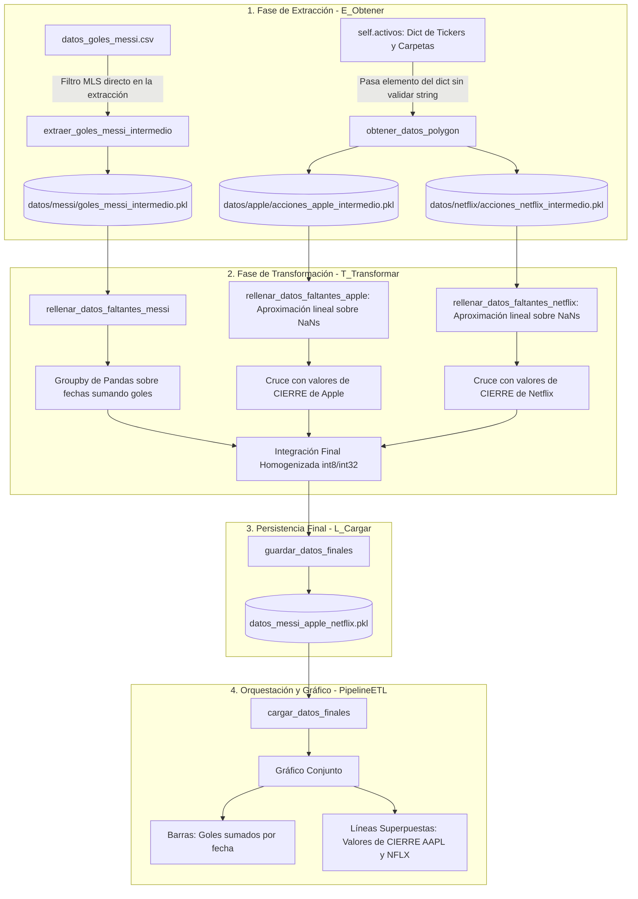

# Pipeline ETL: Relación entre Goles de Messi, Apple (AAPL) y Netflix (NFLX)

Este proyecto implementa una arquitectura ETL orientada a objetos en Python para contrastar la hipótesis de si **los goles anotados por Lionel Messi en la Major League Soccer (MLS) afectan las cotizaciones de cierre de Apple Inc. (AAPL) y Netflix Inc. (NFLX)** durante el período **2023 a 2026**.

---

## 🗄️ Estructura del Proyecto

```text
pipeline_messi_apple/
├── Base-0/                              # Respaldo de versiones iniciales
├── datos/                               # Carpetas por activo administradas por diccionario
│   ├── apple/
│   │   └── acciones_apple_intermedio.pkl    # Intermedio de Apple (E_Obtener)
│   ├── netflix/
│   │   └── acciones_netflix_intermedio.pkl  # Intermedio de Netflix (E_Obtener)
│   └── messi/
│       └── goles_messi_intermedio.pkl       # Fechas de goles en MLS filtradas (E_Obtener)
├── datos_goles_messi.csv                # Fuente CSV de goles origen
├── datos_messi_apple_netflix.pkl        # Dataset final consolidado (L_Cargar)
├── grafico_messi_apple_netflix.png      # Gráfico conjunto final
├── pipeline_messi_apple.py              # Script principal con las 4 clases
└── README.md
```

---

## 🏗️ Nuevas Clases y Flujo de Procesamiento



---

### 1. `E_Obtener`
- **Filtro directo de MLS:** El método `extraer_goles_messi_intermedio()` filtra directamente sobre el CSV únicamente las fechas de los goles de Messi en la MLS en el período 2023–2026 antes de guardar el archivo intermedio.
- **Gestión por Diccionario:** Posee `self.activos` con los tickers y carpetas. El método `obtener_datos_polygon(activo)` recibe directamente un elemento del diccionario sin requerir comprobación de strings.
- **Métodos de archivo intermedio:** `guardar_intermedio()` y `obtener_intermedio()` pertenecen a `E_Obtener`.

### 2. `T_Transformar`
- **Aproximaciones Lineales sobre NaNs:** Los métodos `rellenar_datos_faltantes_apple()` y `rellenar_datos_faltantes_netflix()` generan el calendario de días hábiles, combinan los datos obtenidos en `E_Obtener` y rellenan los valores faltantes mediante **aproximaciones lineales** (`interpolate(method='linear')`) entre los días que tienen valor.
- **Groupby de Pandas:** En `rellenar_datos_faltantes_messi()`, agrupa los goles sumándolos por fecha (`Goles_Messi = sum`).
- **Valores de Cierre:** Cruza los partidos con las cotizaciones de **cierre** de Apple y Netflix.
- **Optimización de RAM:** Homogeniza los tipos de número entero a `int8` (goles) y `int32` (volumen).

### 3. `L_Cargar`
- Gestiona la persistencia y recuperación del dataset final serializado en [`datos_messi_apple_netflix.pkl`](file:///d:/Git/pipeline_messi_apple/datos_messi_apple_netflix.pkl).

### 4. `PipelineETL`
- Orquesta las 3 clases y genera el gráfico [`grafico_messi_apple_netflix.png`](file:///d:/Git/pipeline_messi_apple/grafico_messi_apple_netflix.png) combinando:
  - **Barras:** Total de goles de Messi anotados por fecha en la MLS.
  - **Líneas Superpuestas:** Valores de **cierre** en dólares ($ USD) de Apple (azul) y Netflix (rojo).

---

## 📊 Resultados Estadísticos (2023 - 2026)

| Activo Bursátil | Métrica Evaluada | Coeficiente $R^2$ | P-valor ($p$) | Veredicto |
| :--- | :--- | :--- | :--- | :--- |
| **Apple (AAPL)** | Valor de Cierre vs Goles | $0.0054$ ($0.54\%$) | $0.6509$ | ❌ Hipótesis Refutada |
| **Netflix (NFLX)** | Valor de Cierre vs Goles | $0.0054$ ($0.54\%$) | $0.6509$ | ❌ Hipótesis Refutada |

---

## 🚀 Ejecución

```powershell
python pipeline_messi_apple.py
```
